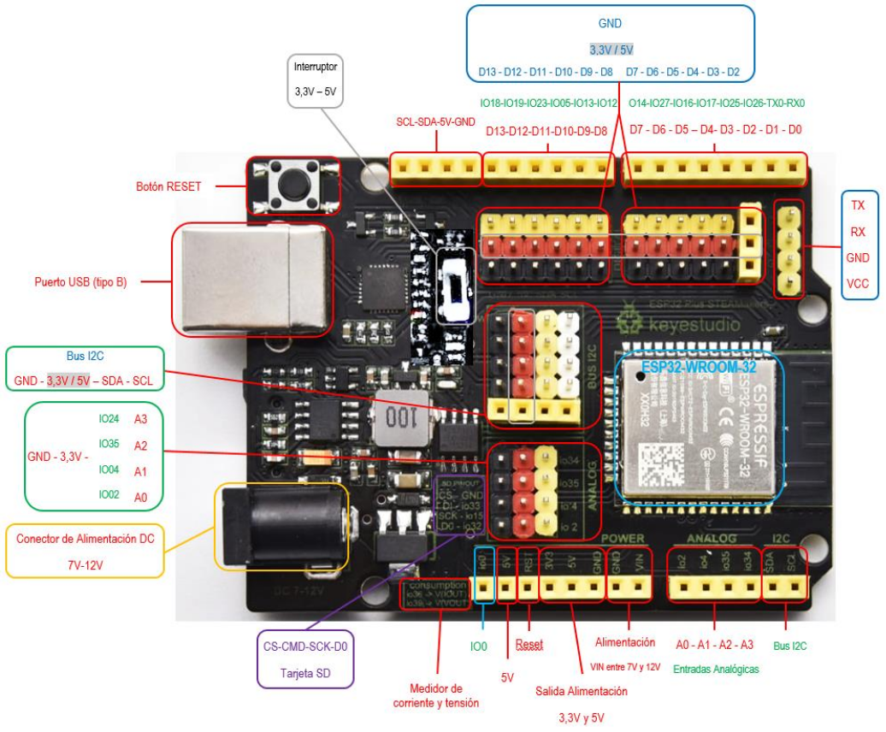
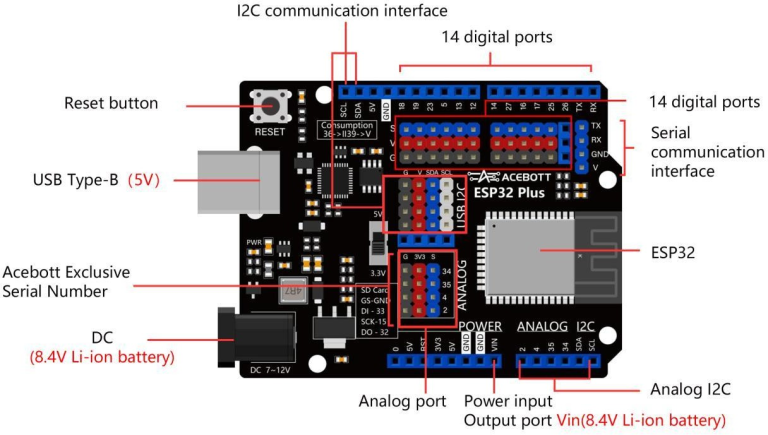

En este apartado vamos a ver el hardware del taller.

Cada uno de estos dispositivos vas a tener un link (se recomienda que se abra en una pestaña o ventana independiente).

## **Placa ESP32**

|[**ESP32 Steamakers**](https://pedroruizf.github.io/steamakers_demo/elemento_de_control.html) |
| :---: |
|  | 
| [**Placa controladora TA825 ESP32 Plus**](https://acebott.com/es/docs/ta825-esp32-plus-controller-board/) |
|
| |

## **Shields**