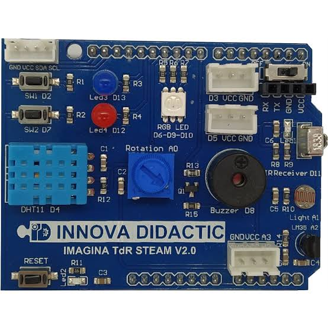
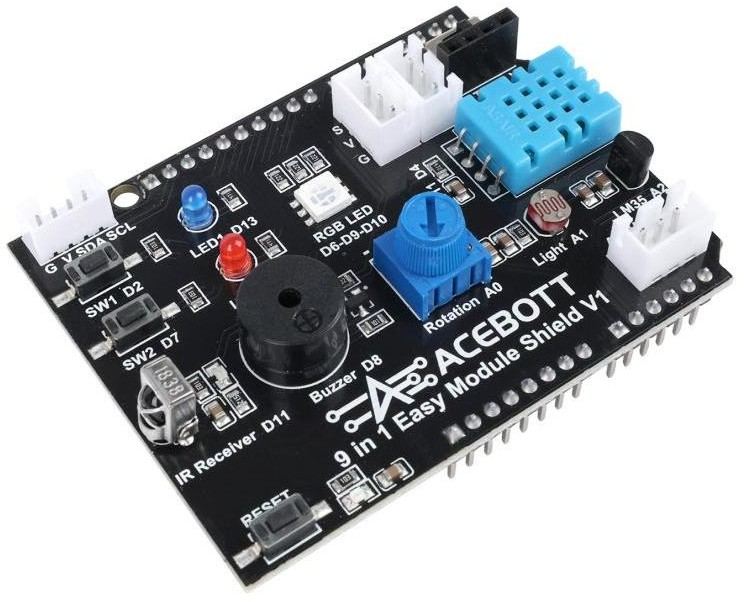

## **Shields**

El Shields o escudo es la placa que tiene los objetos tecnológicos (actuadores y sensores) que vamos a programar para su control.

### **TDR-Steam**

Información elaborada por Pedro Ruiz Fernández del Club Robótica Granada.

|[**TDR-Steam**](https://pedroruizf.github.io/steamakersmicroblocks/html/elemento-de-control.html) |
| :---: |
|  | 

### **TA824 9 en 1**

Información Web comercial.

| [**TA824 9 en 1**](https://acebott.com/es/docs/ta824-9-in-1-easy-module-shield/) |
| :---:|
| |