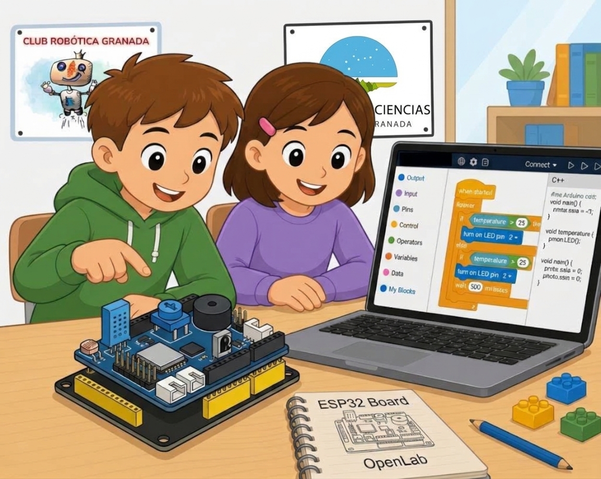

# **Programando Objetos Tecnológicos con ESP32**

{.center}

Repositorio con recursos didácticos para la Robótica Educativa del Club Robótica Granada de talleres de divulgación.

La [placa de control programable ESP32](https://atigra.es/tienda/producto/placa-esp32-steamakers/) es un **recurso didáctico de aprendizaje** para la Robótica Educativa y STEAM (Ciencia, Tecnología, Ingeniería, Arte y Matemáticas), por la potencia de procesamiento (32 bits y doble núcleo), múltiples pines de E/S, conversores analógicos,... permitiendo proyectos científicos-tecnológiocos, robots seguidores de línea, evasores de obstáculos o brazos robóticos. .

**Conectividad inalámbrica integrada**. ESP32 incluye Wi-Fi y Bluetooth en el propio microcontrolador. Esto permite que los estudiantes creen robots controlados por el celular, mandos a distancia vía web o proyectos de IoT (Internet de las cosas) sin necesidad de añadir módulos externos.

**Versatilidad de programación**. Se puede programar de forma intuitiva mediante bloques visuales (ideales para primaria y secundaria), así como con C++ (Arduino IDE) o MicroPython, adaptándose a distintos niveles educativos desde secundaria hasta formación profesional.

Más información:

[ESP32 STEAMakers](https://fgcoca.github.io/ESP32-STEAMakers/hsteamakers/), repositorio de Fede G. Coca

Repositorio en construccion

{.center}
