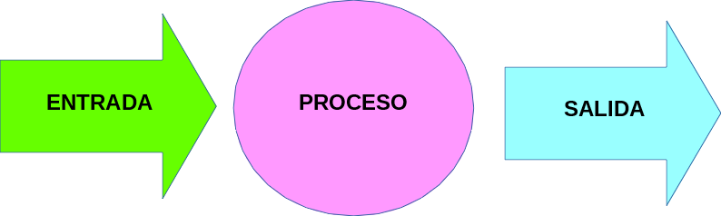
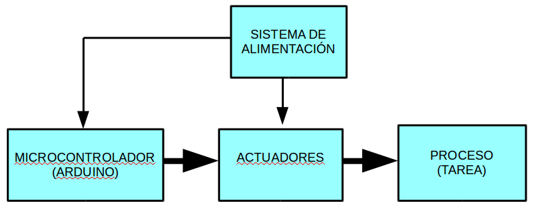
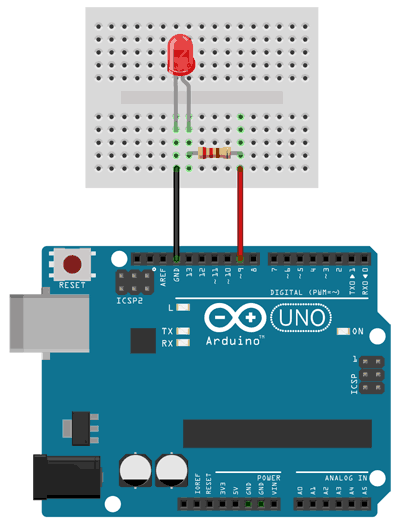
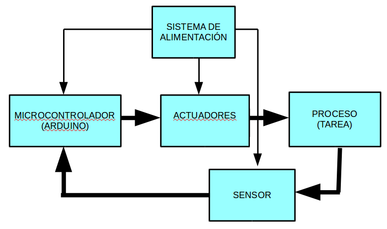
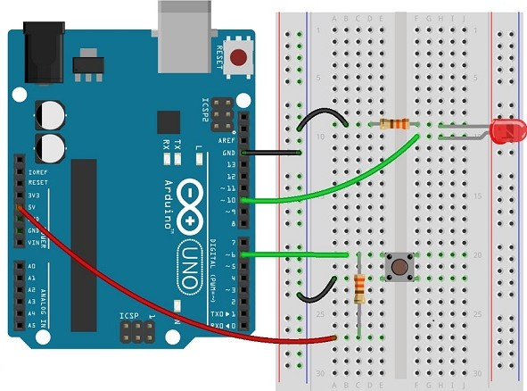

En un sistema de control unos dispositivos (microcontrolador, sensores, actuadores) y tipos de configuración de los dispositivos que forman el sistema de control.

### **Dispositivos**

Los dispositivos básicamente de agrupan en tres bloques.

* **Elementos de entrada**: serán sensores que se le pueden conectar a nuestro sistema de control, pueden ser: pulsadores, interruptores, finales de carrera, ntc, ldr, etc.
  
* **Elementos de proceso o control**: son los que se van a programar, recibirán datos de los elementos de entrada para decidir que realizar con los elementos de salida.

* **Elementos de salida**: van a ser los actuadores, los que va a decidir nuestro programa poner en funcionamiento y de que manera o parar, como: diodos leds, zumbadores, motores, etc.

### **Configuraciones**

### Lazo Abierto

No hay una realimentación, lo que significa el controlador da una orden de puesta en marcha a los actuadores sin que se vigile en ningún momento la señal de los sensores (elementos de entrada).

 

### Lazo Cerrado

Hay realimentación, lo que quiere decir que el sistema de control siempre está vigilando los sensores (elementos de entrada) para realizar una acción u otra en función del estado de los mismos.

