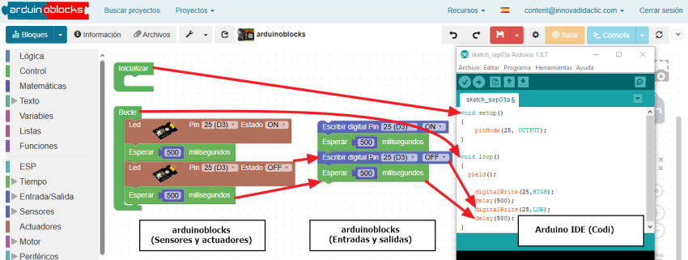

Un IDE (Integrated Development Environment o Entorno de Desarrollo Integrado) es un programa informático con las herramientas necesarias para escribir, probar y corregir código.

### **Funciones principales**

 Un IDE integra las siguientes herramientas en una misma pantalla:

• **Editor de código**: Es el espacio principal donde se escribe el código (Bloque visuales o texto) del programa. Utiliza colores distintos para resaltar bloques o palabras clave facilitando su lectura.

• **Compilador o intérprete**: Es el traductor interno del programa. Convierte las instrucciones escritas en un lenguaje comprensible para el ser humano al lenguaje binario que entiende el microcontrolador o el procesador del ordenador.

• **Depurador (Debugger)**: Es una herramienta que detecta errores de escritura o de lógica antes y durante la ejecución. Señala exactamente en qué línea hay un fallo para ayudar a corregirlo. 

En los lenguajes de bloques visuales no es normal que haya.

• **Terminal o consola**: Es una ventana integrada donde se muestra el resultado final del programa y donde el usuario puede interactuar con él escribiendo datos.

