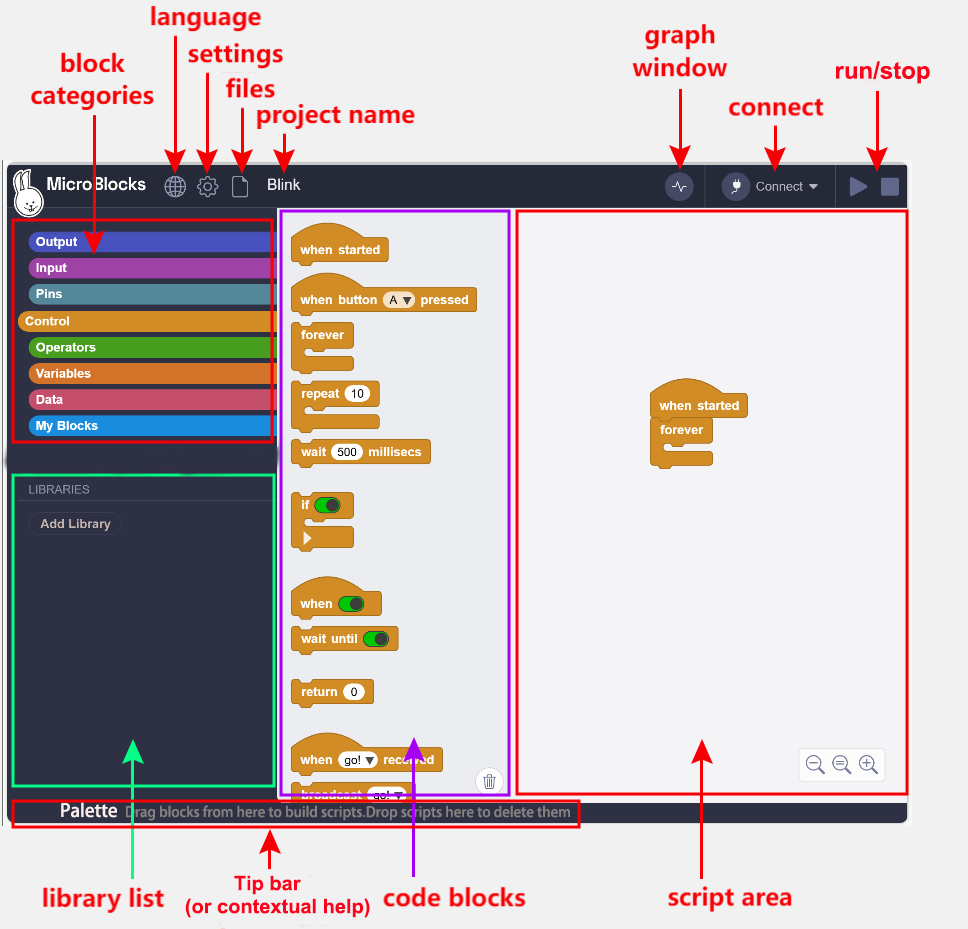
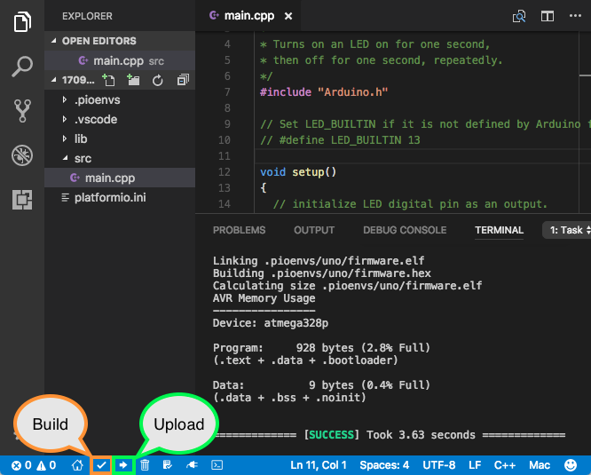

Un lenguaje de programación es un conjunto de símbolos y reglas de sintaxis que escritos con una lógica (algoritmo) resuelve una tarea en un microcontrolador u ordenador. 

En general se puede dividir en dos tipos: visual y textual.

### **Programación Visual (por bloques)**

Los programas se crean arrastrando y encajando bloques gráficos de colores (como si fuera un puzle) en la pantalla, en lugar de escribir palabras o códigos.

### **Programación Textual (por código)**
 
En el programa se escribe el código mediante líneas de texto, palabras clave, números y signos de puntuación usando el teclado.

