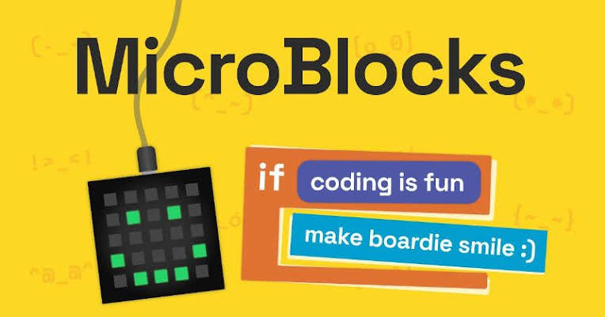
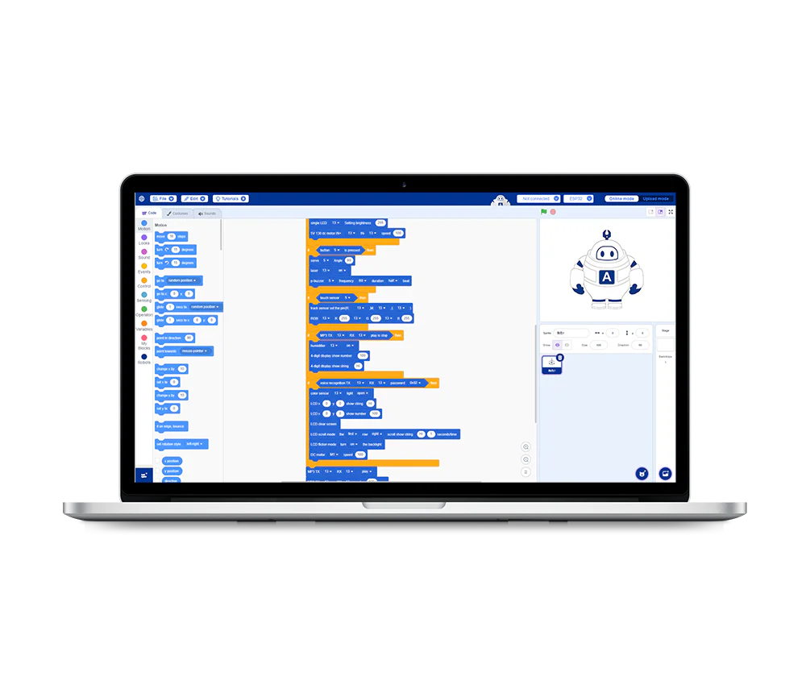
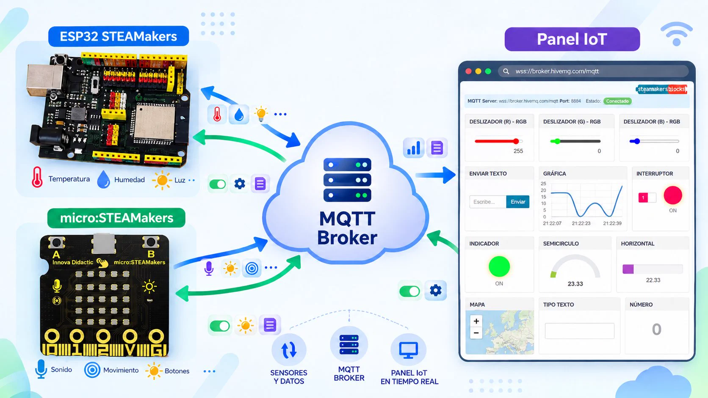

Los lenguajes de programación visual para programar la controladora ESP32, entre otros, son los siguientes:

### **MicroBlocks**

Información elaborada por Pedro Ruiz Fernández del Club Robótica Granada.

|[**MicroBlocks**](https://pedroruizf.github.io/steamakersmicroblocks/html/microblocks.html) |
| :---: |
|  | 

### **ACECode 2.2.1**

Información de Web comercial.

| [**ACECode 2.2.1**](https://acebott.com/es/docs/getting-started-with-acecode/) |
| :---: |
||

### **STEAMakersBlocks**

| [**STEAMakersBlocks**](https://www.steamakersblocks.com/) |
| :---: |
||